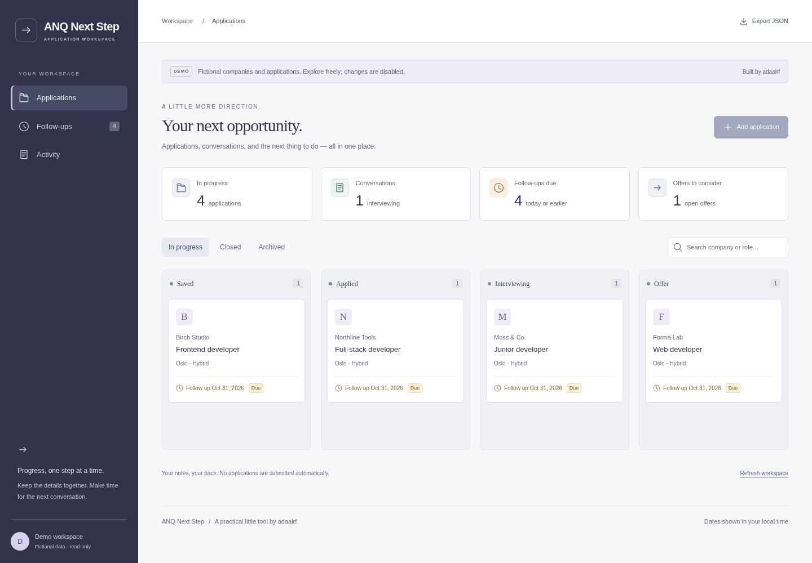

# ANQ Next Step

[](https://github.com/adaalrf/anq-application-tracker/actions/workflows/check.yml)

A private, single-owner job application tracker built with React, TypeScript,
Fastify and PostgreSQL. Keep applications, cover letters, conversations and the
next action together. It does not submit applications or read your email.

[Try the read-only demo](https://tracker.demo.adaalrf.dev) with fictional records.



Navigation keeps the desktop sidebar and uses a labelled, keyboard-accessible mobile
menu with a return-to-top control. Colours follow the device’s light/dark preference.
The browser suite checks both themes and mobile navigation with fictional data.

## Run locally

Requires Linux, Node.js 24+, npm and rootless Podman:

```sh
npm ci
npm run setup:local
npm run dev
```

Open http://localhost:5174. Read your generated owner password privately in
`.local/owner-credentials.json`. Setup creates a PostgreSQL 17 workspace with
fictional records. Repeating it preserves data and credentials; Ctrl-C stops the
API and Vite while the database volume persists. Keep local credentials out of Git.

## Workflow

- Save roles, listing URLs, application addresses, contacts and salary/terms.
- Prepare a plain-text cover letter and next action before applying.
- Track stages from Saved through Applied, Interview and Offer to a closed outcome.
- Record follow-ups and schedule the next date in one save.
- Keep conversation notes and stage changes in the activity history.
- Archive without losing history; export all records and history as JSON.

Stale edits produce a conflict rather than overwriting newer changes. Unsaved-form
warnings do not store drafts. Dates remain calendar dates across timezones.

## Real application workflow

1. Add the company and role; save the listing URL and an email/postal application
   address when needed. Keep it in Saved while preparing.
2. Paste your cover letter, record the next action, and save. You can reopen and
   edit the saved text; the letter is included in export and database backups.
3. Submit to the employer outside Tracker. Set the stage to Applied and record
   the submission date and a follow-up date.
4. Record follow-ups to save what happened, update the next action, and schedule
   the next date (or clear it to finish that follow-up). Update status as it moves
   through interviews, offers, or closure. Archive retains the record and history.

Cover letters are stored as plain text; this release does not upload documents
or submit applications automatically. Daily backups protect saved records, not
unsaved form drafts. See operations for recovery and backup retention.

## Configuration and limits

`.env.example` describes manual configuration. For owner mode use
`DEMO_MODE=false`, `OWNER_USERNAME`, `OWNER_PASSWORD_HASH` and an exact
`APP_ORIGIN`. Generate a hash with `npm run --silent password`, passing the
password on stdin. HTTPS is required outside localhost. Demo mode exposes all
records read-only; use a separate database containing fictional data.

This is a personal workspace: no collaboration, delivered reminders, document
uploads or automatic applications. Lists are unpaginated. The UI shows the latest
500 history entries per application/activity view; export includes all history.
There is no JSON import endpoint. History is append-only through the API, not
protected against database administrators.

## Development and deployment

[Contributing](CONTRIBUTING.md) covers source layout, daily commands and isolated
API/browser tests. [Design](docs/DESIGN.md) explains the data and authorization
boundaries. [Operations](docs/OPERATIONS.md) covers deployment, durable storage,
backups and recovery. Never point tests or demo seeding at a production database.
